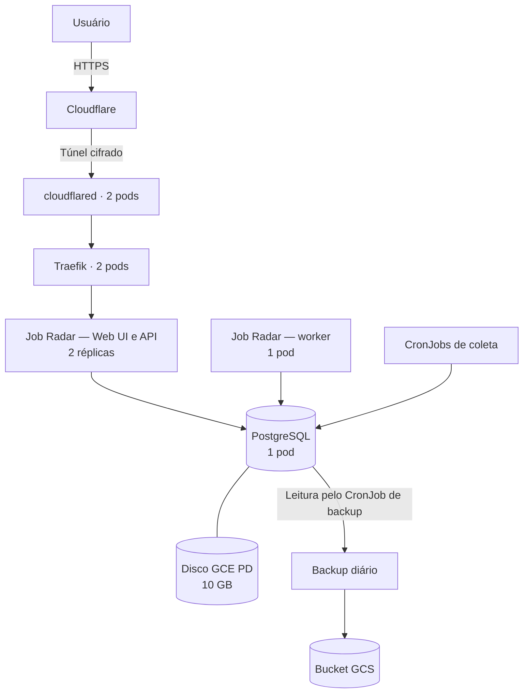
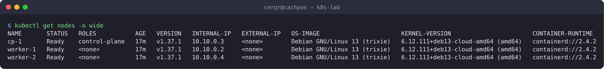

# k8s-lab

Cluster Kubernetes autogerenciado (kubeadm) em 3 VMs na Google Cloud, montado do zero com Terraform e Ansible, acessado só pela tailnet (Tailscale), publicado sem portas abertas (Cloudflare Tunnel) e com deploy por GitOps (Argo CD). A aplicação principal é o [Job Radar](https://github.com/paulocerqr/job-radar), com Web UI no ar em **https://jobradar-lab.utileasy.com.br**.

**Status**: Quando os creditos gratuitos GPC acabarem, o sistema Job Radar será migrado para um unico servidor Oracle(4vCPU + 24GB de RAM) e rodará com kubernetes(k3s)

## Teste o Job Radar

Acesse [jobradar-lab.utileasy.com.br](https://jobradar-lab.utileasy.com.br) com a conta pública de demonstração:

| Campo | Valor |
|---|---|
| E-mail | `usuario_teste@gmail.com` |
| Senha | `usuarioteste01` |

O [currículo fictício para teste](docs/curriculo-teste.md) representa um estudante em busca de estágio em desenvolvimento fullstack, com Python, JavaScript, React, NestJS, PostgreSQL e Java. Ele pode ser usado na seção **Meu perfil** para testar a análise de aderência das vagas.

A conta é compartilhada entre visitantes. Use apenas dados fictícios e preserve as credenciais para que outras pessoas também possam testar.

## Em números

| | |
|---|---|
| Do zero ao cluster pronto (Terraform + Ansible, sem passo manual) | **≈ 6 min** (medido em 19/10, antes das etapas de plataforma) |
| Do merge no Job Radar à versão nova no ar (CI → commit do bot → Argo CD) | **≈ 6 min**, 478 de 478 respostas `200` durante o deploy |
| Rollouts e drain do `worker-2` depois do `preStop` | **0 erros** (378 e 216 requisições) |
| Drain do `worker-1` (onde está o banco) | `503` por **36 s** com disco gerenciado (antes: 77 s, preso ao nó) |
| Backup do Postgres | Diário no GCS, **restauração testada**; o cluster não consegue apagar backups (403) |
| Memória reservada pelo Job Radar após medir o uso real | 832 Mi → **512 Mi** |

## Arquitetura

O **cluster** reúne três **nós** (VMs). Cada nó executa **pods**, que abrigam os containers dos programas. O diagrama mostra o fluxo do Job Radar; a tabela abaixo mostra a distribuição dos principais pods nos servidores.



Os componentes entre o `cloudflared` e o backup executam no cluster Kubernetes; a Cloudflare, o disco GCE PD e o bucket GCS são serviços externos aos pods.

Os dois pods da API do Job Radar são réplicas da mesma aplicação: ambos servem a Web UI e a API e compartilham o mesmo banco PostgreSQL.

O `cloudflared` inicia as conexões de saída para a Cloudflare; as setas mostram o caminho das requisições, sem abertura de portas públicas de entrada. O tráfego interno passa pelos Services do Kubernetes e pode atravessar os nós: não há um caminho fixo entre pods do mesmo servidor.

| Nó | Recursos | Principais pods na distribuição observada em 29/10/2026 |
|---|---|---|
| `cp-1` | 4 vCPU / 16 GB RAM | Controle do Kubernetes, Prometheus, Grafana e Argo CD |
| `worker-1` | 2 vCPU / 8 GB RAM | cloudflared, Traefik, API, worker e Postgres |
| `worker-2` | 2 vCPU / 8 GB RAM | cloudflared, Traefik e API |

A distribuição pode mudar quando o Kubernetes recria ou reagenda pods, respeitando as regras de cada aplicação. O Postgres usa disco gerenciado e pode mudar de worker; os dados do Prometheus ficam no disco local do `cp-1`. Pods auxiliares foram omitidos para simplificar a leitura.

O control plane coordena o cluster. O Prometheus coleta métricas, e o Grafana as apresenta em painéis. O Argo CD sincroniza as aplicações com o repositório `k8s-lab`. A administração usa SSH e `kubectl` pela tailnet do Tailscale.

### Onde fica cada configuração

| Diretório | Responsabilidade |
|---|---|
| [`terraform/`](terraform/) | Cria a infraestrutura na Google Cloud |
| [`ansible/`](ansible/) | Instala e configura o cluster e a plataforma |
| [`cluster/`](cluster/) | Define os componentes da plataforma, como Traefik, cloudflared e monitoramento |
| [`apps/`](apps/) | Define as aplicações, incluindo API, worker, Postgres e CronJobs do Job Radar |
| [`argocd/`](argocd/) | Define quais aplicações e caminhos do Git o Argo CD sincroniza |

### Componentes e escolhas

| Camada | Escolha | Documento |
|---|---|---|
| Infraestrutura | Terraform: VPC, firewall, 3 VMs Debian 13, IAM mínimo, bucket | [01](docs/01-terraform.md) |
| Acesso | Tailscale (SSH e API do Kubernetes pela tailnet); IAP de emergência | [02](docs/02-acesso-tailscale.md) |
| Cluster | kubeadm 1.37, containerd 2.4, Cilium 1.20 com kube-proxy replacement | [03](docs/03-kubeadm.md), [05](docs/05-entrada.md) |
| Automação | Ansible idempotente (`site.yml`) | [04](docs/04-ansible.md) |
| Entrada | Traefik pela Gateway API + Cloudflare Tunnel | [05](docs/05-entrada.md), [07](docs/07-cloudflare-tunnel.md) |
| Segredos | Sealed Secrets (cifrados no Git) | [06](docs/06-plataforma.md) |
| Armazenamento | local-path (Prometheus) e GCE PD CSI (Postgres) | [06](docs/06-plataforma.md), [11](docs/11-discos-gerenciados.md) |
| Observabilidade | kube-prometheus-stack no `cp-1` | [08](docs/08-observabilidade.md) |
| Deploy | Argo CD (app-of-apps) + CI do Job Radar | [13](docs/13-argocd.md) |

## Documentação

| Documento | Conteúdo |
|---|---|
| [00 — Ferramentas](docs/00-ferramentas.md) | O que é cada ferramenta e como foi instalada |
| [01 — Terraform](docs/01-terraform.md) | Cada arquivo e recurso, IAM, comandos executados |
| [02 — Acesso pelo Tailscale](docs/02-acesso-tailscale.md) | Tag, auth key, registro automático dos nós e SSH |
| [03 — Cluster com kubeadm](docs/03-kubeadm.md) | Instalação manual passo a passo e problemas encontrados |
| [04 — Ansible](docs/04-ansible.md) | Playbooks, idempotência e o teste de recriação do zero |
| [05 — Entrada do cluster](docs/05-entrada.md) | Cilium no lugar do kube-proxy; Traefik pela Gateway API |
| [06 — Plataforma](docs/06-plataforma.md) | local-path e Sealed Secrets |
| [07 — Cloudflare Tunnel](docs/07-cloudflare-tunnel.md) | Publicação em HTTPS sem portas abertas |
| [08 — Observabilidade](docs/08-observabilidade.md) | Prometheus, Alertmanager e Grafana |
| [09 — Job Radar](docs/09-job-radar.md) | O app no cluster, a Web UI (exposição pública, CSP) e os problemas do primeiro deploy |
| [10 — Resiliência](docs/10-resiliencia.md) | Drain, rollout/rollback e kill de pods medidos de fora; `preStop`; trava do worker |
| [11 — Discos gerenciados](docs/11-discos-gerenciados.md) | GCE PD CSI e a migração do Postgres sem perda |
| [12 — Backup](docs/12-backup.md) | `pg_dump` diário no GCS; restauração testada; o Terraform que ia desanexar o disco |
| [13 — Argo CD](docs/13-argocd.md) | GitOps: app-of-apps, ondas, migração como hook, deploy ponta a ponta |
| [14 — Recursos](docs/14-recursos.md) | Requests/limites pelo uso medido; a liveness que inflava a memória |
| [Plano](docs/plano.md) | Objetivos, decisões (K01–K25), cronograma e checklist de encerramento |

**Incidentes:** [001 — Debian da GCP sem cloud-init](docs/incidentes/001-cloud-init-debian-gcp.md) · [002 — Gateway API do Cilium com backend no mesmo nó](docs/incidentes/002-gateway-cilium-backend-mesmo-no.md) (bug [cilium#47940](https://github.com/cilium/cilium/issues/47940)).

**Evidências** (saídas reais dos comandos): [semana 1](docs/evidencias/semana-1/README.md) (Terraform, Ansible, nós) · [semana 2](docs/evidencias/semana-2/README.md) (entrada, túnel, monitoramento) · [semana 3](docs/evidencias/semana-3/README.md) (Job Radar no cluster) · [semana 4](docs/evidencias/semana-4/README.md) (resiliência, discos, backup, Argo CD, recursos).



## O que deu errado (e virou aprendizado)

| Problema | O que ensinou |
|---|---|
| Debian da GCP sem cloud-init: nós fora da tailnet | Conferir o que a imagem realmente suporta (`startup-script`) |
| Gateway API do Cilium sem resposta para backend no mesmo nó | Isolar a falha até virar um bug reproduzível; trocar de ferramenta quando o prazo pede |
| `502` em toda troca de pods | Corrida entre `SIGTERM` e remoção dos endpoints; `preStop` |
| `Recreate` não impede 2 workers num delete de pod | Garantia de instância única é do app (trava no Postgres), não da estratégia de deploy |
| Terraform ia desanexar o disco do Postgres | Cada campo com um só dono (`ignore_changes`); ler o `plan` sempre |
| Memória do worker crescendo 115 Mi/dia | Métrica ≠ processo: o `working_set` incluía cache do kernel gerado pela liveness |
| Argo CD `OutOfSync` para sempre | Valores padrão do servidor; comparação pelo servidor (`ServerSideDiff`) |
| Redirect da Web UI para `http://` atrás do túnel | Atrás de proxy, URL absoluta gerada pelo app herda o esquema interno; redirect só com o caminho |

## Reproduzindo

Pré-requisitos: `gcloud`, `terraform`, `ansible`, `kubectl`, `helm`, `kubeseal`; projeto GCP com faturamento e Compute Engine API; Tailscale com `tag:k8s-lab` nas ACLs; a cópia da chave do Sealed Secrets em `~/.config/k8s-lab/` (sem ela, os SealedSecrets do Git precisam ser recriados).

Para publicar as aplicações, o túnel e as rotas de hostname precisam ser configurados no painel da Cloudflare, com o token correspondente no SealedSecret. Essa preparação externa está descrita em [07 — Cloudflare Tunnel](docs/07-cloudflare-tunnel.md#passo-a-passo-como-foi-feito); o `site.yml` instala o conector no cluster, mas não cria o túnel nem suas rotas no painel.

```bash
gcloud auth application-default login
cd terraform && cp terraform.tfvars.example terraform.tfvars   # projeto e auth key do Tailscale
terraform init && terraform plan -out plano && terraform apply plano
cd ../ansible && ansible-playbook site.yml                      # cluster, plataforma e Argo CD
# o Argo CD aplica o Job Radar a partir do Git
```

Nada sensível vai para o Git: `terraform.tfvars`, state, kubeconfig, tokens e a chave do Sealed Secrets ficam fora (`.gitignore` e `~/.config/k8s-lab/`, permissão `600`).

> O teste de recriação do zero foi feito em 19/10, antes de túnel, monitoramento, PD CSI e Argo CD entrarem no `site.yml`; repeti-lo com tudo é um item do encerramento.

## Créditos e encerramento

O lab roda com créditos que expiram em **16/11/2026**. O checklist de encerramento ([plano §7](docs/plano.md)) cobre o backup final, o custo real consumido, os discos do PD CSI (que o `terraform destroy` não apaga) e a conferência no console.
