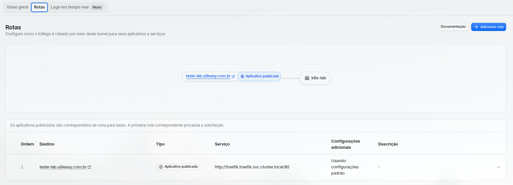

# 07 — Cloudflare Tunnel: publicação sem portas abertas

O lab publica aplicações em HTTPS sem nenhuma porta de entrada aberta na GCP. Quem abre a conexão é o próprio cluster: o **cloudflared** liga **para fora**, para a Cloudflare, e as requisições dos usuários chegam por esse túnel.

## O caminho

```
navegador ══HTTPS══► Cloudflare ══túnel cifrado══► cloudflared (pod) ──HTTP──► Traefik ──► app
           (certificado            (conexões de SAÍDA      (namespace        (Gateway "lab",
            Universal SSL)          abertas pelo cluster)    cloudflared)      HTTPRoute por host)
```

| Trecho | Protocolo | Quem cuida |
|---|---|---|
| Navegador → Cloudflare | HTTPS | Certificado grátis da Cloudflare (um nível de subdomínio: K25) |
| Cloudflare → cluster | Túnel cifrado (QUIC/HTTP2) | `cloudflared`, 4 conexões por réplica |
| cloudflared → Traefik | **HTTP** | Rede interna do cluster |
| Traefik → app | HTTP | `HTTPRoute` de cada app |

O firewall da GCP continua sem nenhuma regra para 80/443 (`saidas/06-firewall-sem-portas-http.txt` nas evidências).

## As peças

| Peça | Onde | Para quê |
|---|---|---|
| Túnel `k8s-lab` | Painel da Cloudflare (*Rede → Túneis*) | Identidade do túnel e as **rotas** (hostname → serviço) |
| Token do túnel | `~/.config/k8s-lab/cloudflared-token` (local, `600`) | Credencial do conector. **Nunca** vai para o Git em texto puro |
| `cluster/cloudflared/sealedsecret.yaml` | Git | O token **cifrado** com a chave do Sealed Secrets; só o controlador do cluster abre |
| `cluster/cloudflared/deployment.yaml` | Git | 2 réplicas (uma por worker), PDB, probes em `/ready`, sem privilégios |
| `ansible/playbooks/09-cloudflared.yml` | Git | Aplica tudo e espera as réplicas conectarem |
| `cluster/teste/whoami.yaml` | Git | App de teste em `teste-lab.utileasy.com.br` |

## Passo a passo (como foi feito)

### 1. Túnel no painel (você)

*Rede → Túneis → Criar túnel* → tipo **cloudflared**, nome `k8s-lab`. Os comandos de instalação que a tela mostra (Debian/`service install`) **não são usados**: o conector roda como pod. Só o **token** (o texto `eyJ...` depois de `--token`) interessa.

### 2. Token num arquivo local, sem passar pelo terminal visível

```bash
mkdir -p ~/.config/k8s-lab && chmod 700 ~/.config/k8s-lab
read -rs TOKEN && printf '%s' "$TOKEN" > ~/.config/k8s-lab/cloudflared-token && unset TOKEN
chmod 600 ~/.config/k8s-lab/cloudflared-token
```

`read -rs` lê sem mostrar e sem gravar no histórico do shell.

### 3. Token cifrado para o Git (Sealed Secrets)

```bash
kubectl create secret generic tunnel-token -n cloudflared \
  --from-file=token=$HOME/.config/k8s-lab/cloudflared-token \
  --dry-run=client -o yaml \
| kubeseal --format yaml > cluster/cloudflared/sealedsecret.yaml
```

`--dry-run=client` monta o Secret só na memória (nada vai para o cluster em texto puro); o `kubeseal` cifra com a chave pública do controlador. O resultado só funciona **neste namespace e com este nome**, e só neste cluster (ou num recriado com a mesma chave, ver [06-plataforma.md](06-plataforma.md)).

### 4. Conector no cluster

```bash
cd ansible && ansible-playbook playbooks/09-cloudflared.yml
```

No log de cada réplica aparecem 4 linhas `Registered tunnel connection` (datacenters `ord`, Chicago, os mais próximos de Iowa). No painel, o túnel passa de "Inativo" para "Íntegro".

### 5. Rota no painel (você)

No túnel → **Rotas → Adicionar rota → aplicativo publicado**:

| Campo | Valor |
|---|---|
| Subdomínio / domínio | `teste-lab` / `utileasy.com.br` |
| Tipo do serviço | **HTTP** |
| URL | `traefik.traefik.svc.cluster.local:80` |

A Cloudflare cria sozinha o registro DNS. **Toda rota aponta para o Traefik**; quem escolhe o app é a `HTTPRoute` pelo nome do host.

> ⚠️ **Tipo HTTP, não HTTPS.** Com `https://`, o cloudflared tenta TLS na porta 80 do Traefik e a Cloudflare devolve **502 Bad Gateway**. No log do cloudflared: `tls: failed to verify certificate`. Aconteceu na primeira tentativa; corrigido trocando o tipo da rota.

---

---

### 6. Teste

```bash
for i in $(seq 1 8); do curl -s https://teste-lab.utileasy.com.br | grep ^Hostname; done | sort | uniq -c
#   4 Hostname: whoami-...-4t4xv
#   4 Hostname: whoami-...-68ntd
curl -sI https://teste-lab.utileasy.com.br    # HTTP/2 200, server: cloudflare
```

## Publicar um app novo

1. No Git: `Service` + `HTTPRoute` com `hostnames: ["<app>-lab.utileasy.com.br"]` e `parentRefs: [{name: lab, namespace: traefik}]`.
2. No painel: rota `<app>-lab.utileasy.com.br` → **HTTP** `traefik.traefik.svc.cluster.local:80`.

## Trocar (rotacionar) o token

1. Painel do túnel → **Rotacionar token** (o anterior deixa de valer).
2. Gravar o novo em `~/.config/k8s-lab/cloudflared-token` (passo 2).
3. Gerar de novo o `sealedsecret.yaml` (passo 3), commitar e rodar o `09-cloudflared.yml`.
4. Reiniciar o conector: `kubectl -n cloudflared rollout restart deployment/cloudflared`.

## Conferindo

```bash
kubectl -n cloudflared get pods -o wide
kubectl -n cloudflared logs deploy/cloudflared | grep -E "Registered|ERR"
kubectl get httproute -A
```
