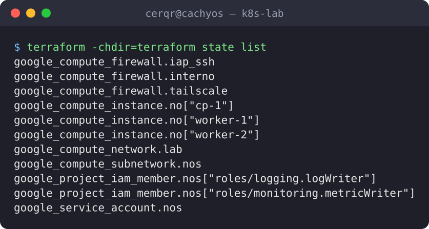
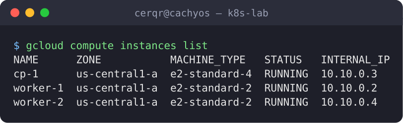
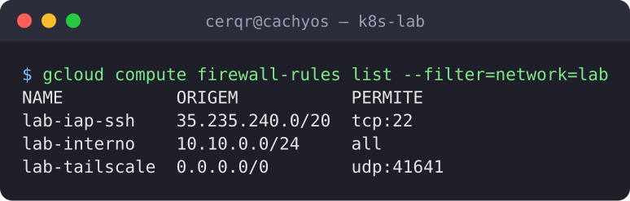
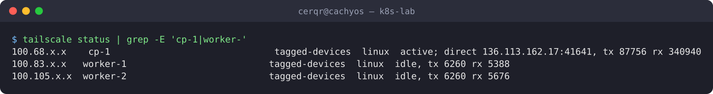
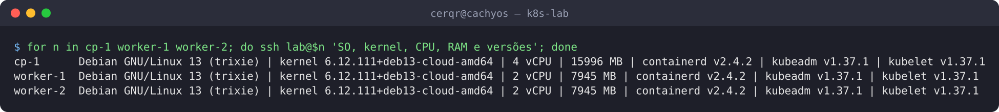
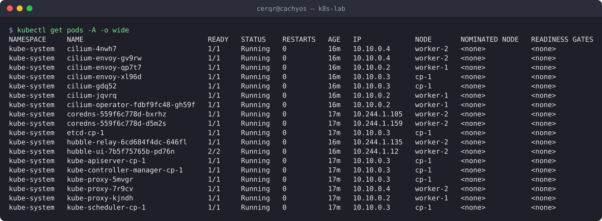
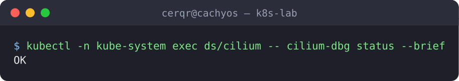
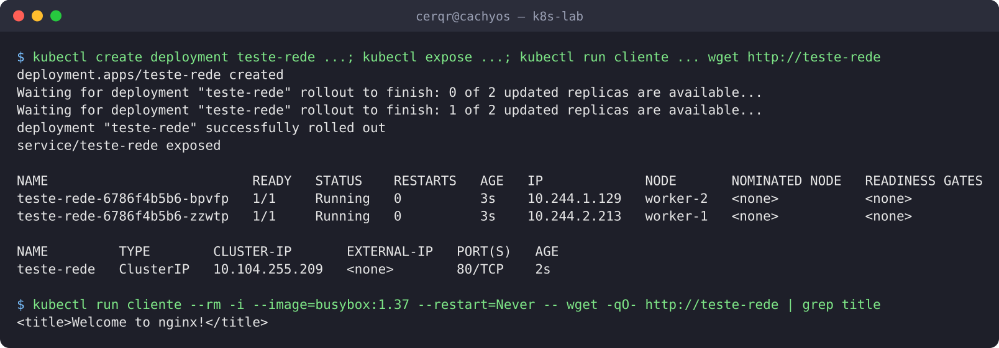
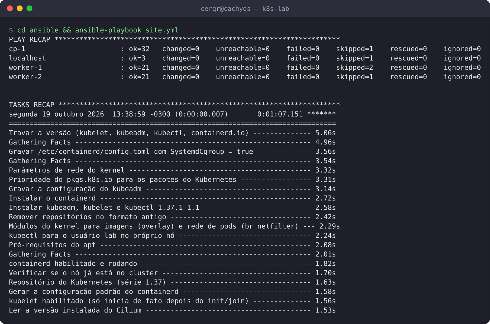

# Evidências: infraestrutura e cluster

Saídas reais dos comandos de verificação, capturadas em **19/10/2026** no cluster **recriado do zero** com Terraform + Ansible ([04-ansible.md](../../04-ansible.md)).

As imagens são geradas a partir do texto pelo [`scripts/terminal-png.py`](../../../scripts/terminal-png.py); o texto completo de cada uma está em [`saidas/`](saidas). Nome da tailnet, ID do projeto e IPs da tailnet aparecem mascarados (`<tailnet>`, `<projeto>`, `100.x.x.x`) pelo [`scripts/capturar-evidencias.sh`](../../../scripts/capturar-evidencias.sh).

| # | Evidência | Comprova |
|---|---|---|
| 1 | [Recursos do Terraform](#1-recursos-gerenciados-pelo-terraform) | Toda a infraestrutura vem do código |
| 2 | [VMs na GCP](#2-vms-na-gcp) | 3 nós na mesma zona, só IPs internos na listagem |
| 3 | [Firewall](#3-firewall-nenhuma-porta-de-entrada-aberta) | Nenhuma porta de entrada aberta para a internet |
| 4 | [Nós na tailnet](#4-nós-na-tailnet) | Acesso só pela rede privada, com tag |
| 5 | [Versões em cada nó](#5-versões-em-cada-nó) | Os 3 nós idênticos, configurados pelo Ansible |
| 6 | [Nós do Kubernetes](#6-nós-do-kubernetes) | Cluster de 3 nós `Ready` |
| 7 | [Pods do sistema](#7-pods-do-sistema) | Control plane, CNI, DNS e Hubble rodando |
| 8 | [Cilium](#8-cilium) | CNI saudável |
| 9 | [Teste de rede](#9-teste-de-rede-entre-nós) | Pods em nós diferentes se comunicam por nome |
| 10 | [Ansible idempotente](#10-ansible-idempotente) | Rodar de novo não muda nada (`changed=0`) |

---

## 1. Recursos gerenciados pelo Terraform



Os 11 recursos da GCP (rede, subnet, 3 regras de firewall, conta de serviço, 2 permissões e 3 VMs) estão no state do Terraform: nada foi criado à mão no console. Saída do `terraform output`: [02-terraform-output.txt](saidas/02-terraform-output.txt) · [imagem](img/02-terraform-output.png).

## 2. VMs na GCP



`cp-1` (e2-standard-4) e dois workers (e2-standard-2), todos em `us-central1-a`, na subnet `10.10.0.0/24` da VPC própria do lab.

## 3. Firewall: nenhuma porta de entrada aberta



| Regra | Leitura |
|---|---|
| `lab-interno` | Tráfego só **entre os nós** (`10.10.0.0/24`) |
| `lab-tailscale` | UDP 41641: conexão direta do Tailscale (não expõe serviço algum) |
| `lab-iap-ssh` | SSH **só** a partir da faixa do IAP do Google (emergência) |

Não há regra para 22, 6443, 80 ou 443 vinda da internet.

## 4. Nós na tailnet



Os 3 nós com a identidade `tagged-devices` (`tag:k8s-lab`): entraram sozinhos no boot pelo `startup-script` e são acessados por SSH e `kubectl` só por essa rede.

## 5. Versões em cada nó



Mesmo SO, kernel, containerd 2.4.2 e Kubernetes 1.37.1 nos três: resultado dos playbooks `00-base` e `01-kubernetes-pacotes`.

## 6. Nós do Kubernetes


3 nós `Ready`, cada um com seu IP na VPC, runtime `containerd://2.4.2`. O `kubectl` roda no PC de administração, chegando ao API server pela tailnet.

## 7. Pods do sistema



| Componente | Onde |
|---|---|
| etcd, kube-apiserver, kube-scheduler, kube-controller-manager | `cp-1` (static pods) |
| cilium, cilium-envoy, kube-proxy | um por nó (DaemonSets) |
| coredns, hubble-relay, hubble-ui, cilium-operator | workers |

## 8. Cilium



Versões de cliente e servidor do Kubernetes: [10-kubectl-version.txt](saidas/10-kubectl-version.txt) · [imagem](img/10-kubectl-version.png).

## 9. Teste de rede entre nós



| Observado | Comprova |
|---|---|
| Pods em `worker-1` e `worker-2`, com IPs de faixas `/24` diferentes | IPAM do Cilium: cada nó com sua faixa do `podSubnet` |
| Service com IP `10.96.0.0/12` | kube-proxy criando IPs virtuais |
| `<title>Welcome to nginx!</title>` | CoreDNS resolveu o nome e o tráfego atravessou nós pelo VXLAN |

## 10. Ansible idempotente



Execução real do `site.yml` contra o cluster já configurado: **`changed=0` e `failed=0` em todos os hosts**, ou seja, o estado real é exatamente o descrito no código. A saída completa, tarefa por tarefa, está em [12-ansible-site.txt](saidas/12-ansible-site.txt).

Tempos do teste de recriação do zero (`terraform apply` 123 s + nós na tailnet 20 s + `ansible-playbook` 217 s ≈ **6 min**) estão em [04-ansible.md](../../04-ansible.md#3-recriação-do-zero-19102026).

---

## Como regenerar

```bash
scripts/capturar-evidencias.sh docs/evidencias/semana-1/saidas
for f in docs/evidencias/semana-1/saidas/*.txt; do
  n=$(basename "$f" .txt); [ "$n" = 12-ansible-site ] && continue
  python3 scripts/terminal-png.py "$f" "docs/evidencias/semana-1/img/$n.png" --linhas 40
done
```

O teste de rede cria e apaga recursos temporários no namespace `default`; o resto só lê.
